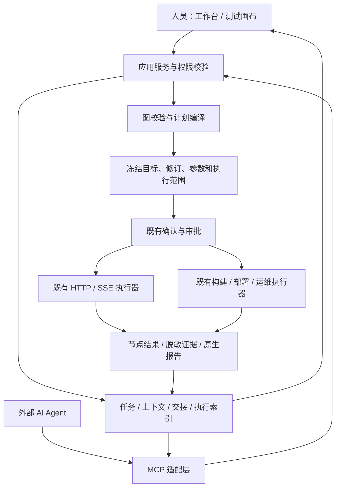

# AI Agent 研发协作与接口测试画布设计

设计日期：2026-11-13。状态：设计提案，尚未实现。

目标：让开发、测试、运维人员与外部 AI Agent 共用任务上下文、研发资产和执行证据，完成可交接、可核对的日常工作。接口测试采用可执行的无限画布，人和 Agent 操作同一份测试定义。

本设计依据 `worktrees/devopsplatform-delivery-v1` 当前本地代码与文档；不代表线上部署版本。交互示意中的应用、任务和运行结果均为合成数据。

## 1. 产品定位与职责

平台负责业务事实、权限、工具、任务记录、执行和证据。Agent 负责理解任务、制定步骤、编写代码、生成用例、分析结果和提出修改。人员负责业务验收、必要的操作确认，以及团队规则维护。

首期优先支持现有外部 Agent 通过 MCP 接入。开发者继续在自己的代码工作区开发；平台保存仓库、分支、Commit、构建与交付的关联。内置模型、聊天入口和常驻自主 Agent 可以后续接入，不作为首期前置条件。

研发任务、接口测试和部署编排各自保留业务含义：任务描述目标和交接，测试画布描述验证过程，部署编排负责环境交付。三者共享身份、上下文、执行引用与证据契约。

## 2. 当前基础与新增范围

| 领域 | 当前分支已有基础 | 本次设计新增 |
| --- | --- | --- |
| Agent 接入 | MCP、用户绑定令牌、应用/环境范围、工具审计、冻结预览与确认 | 能力发现、统一任务上下文、任务认领与交接、结构化结果提交 |
| 研发协作 | 需求/Bug、代码/SQL/Nacos 变更、构建和交付关联 | 任务执行记录、验收条件、带来源的上下文包、跨 Agent 交接 |
| 接口资产 | 不可变文档快照、接口归属、文档差异与用例影响 | 图节点精确引用接口快照，Agent 修改建议与差异审阅 |
| 测试用例 | 多步骤、HTTP/SSE、参数集、断言、响应提取、团队用例、测试集与跨用例变量 | 无限画布、稳定节点 ID、图修订、图校验、用例读写 MCP |
| 测试执行 | 同一 HTTP/SSE 执行器、异步记录、停止、幂等、未知状态、交付测试节点 | 节点结果映射、统一执行索引、图版本与运行版本对照 |
| 缺陷证据 | 测试/日志关联 Bug、按原修订回归、私人报告隔离 | 显式共享的脱敏证据包、按权限生成交接材料 |
| 运维协作 | 日志/指标/Trace、发布记录、资源绑定与受控操作 | 诊断任务、变更时间线、候选原因和验证计划的统一提交 |

已核对的主要依据：`deploy/API-TESTING.md`、`deploy/WORKFLOW-UNIFICATION.md`、`internal/devtools/api_testing.go`、`internal/deploy/api_testing.go`、`internal/deploy/api_testing_collections.go`、`internal/deploy/api_testing_bindings.go`。

当前 MCP 测试工具支持上下文、认证配置、认证验证、单请求/指定修订用例执行和本人报告读取。它尚不等于完整的用例/测试集管理、任务交接或图编辑协议。

## 3. 日常工作闭环

### 3.1 开发与缺陷修复

1. 人员从现有工作项创建协作任务，补充验收条件，关联应用与仓库。
2. 开发 Agent 认领任务，读取上下文包：需求、Bug 证据、接口文档、相关变更、代码引用与团队约定。
3. Agent 在代码工作区修改，提交代码后将实际 Commit、改动说明、验证结果和未解决事项回写任务。
4. 按现有流程登记变更、构建并交付测试环境。每个有副作用的操作沿用现有授权与确认。
5. 移交测试任务，带上准确 Commit/制品、已部署环境、推荐用例与影响范围。
6. 验证结果进入任务证据区，人员完成业务验收。源 Bug 状态通过已有来源平台流程明确修改。

### 3.2 接口测试

1. 测试人员或 Agent 从需求和接口文档生成用例草稿，标明业务预期的来源。
2. 在画布编排接口、变量和断言；审阅 Agent 的节点/参数/断言差异并保存新修订。
3. 选择测试环境与已配置入口，检查待执行修订、参数组和目标，再执行。
4. 运行过程中节点显示状态；失败时定位实际值、预期值和原始证据。
5. 创建或关联 Bug，显式共享必要的脱敏证据；开发 Agent 获取交接后修复。
6. 回归生成新运行，保留原失败记录。Agent 不得为了让用例通过而用实际响应替换业务预期。

### 3.3 运维处理

1. 从告警、异常日志或发布单创建诊断任务，固定应用、环境和时间范围。
2. Agent 查询日志/Trace/指标和发布变更，给出“观察到的事实、原因候选、支持证据、待核实项”。
3. 提交处理建议，通过现有工具和执行流程操作。
4. 在约定窗口验证恢复，记录数据完整性、指标和业务验证。无数据记为无法判断。
5. 形成可复用的复盘与运行手册草稿，关联真实处理记录。

## 4. 页面与信息架构

| 现有位置 | 新增交互 |
| --- | --- |
| 研发工作台 / 工作项详情 | 协作任务、验收条件、活动与证据；按需打开上下文和交接详情 |
| 接口中心 / 测试用例 | 列表管理；用例详情提供步骤/画布两种视图 |
| 接口中心 / 测试集 | 按顺序组合用例、参数组与变量映射；后续可提供用例级画布 |
| 接口中心 / 执行记录 | 按原修订查看运行图、步骤报告、证据与差异 |
| 应用环境 / 日志 / 监控 | 从当前对象发起诊断任务，携带精确范围 |
| MCP 管理 | 现有权限管理和 Skill 分发，增加能力与任务协作说明 |

沿用 shadcn-vue（Nova/Neutral）和现有工作区机制。页面切换保留原列表、筛选和草稿；Agent 建议在当前编辑器审阅。日常流程中复用已配置的资源、认证和环境入口。

## 5. 无限画布的产品设计

### 5.1 页面结构

- 顶部：用例名称、保存状态、当前内容修订、布局入口、运行入口。
- 中间：可缩放和平移的画布，节点拖拽、连线、框选、撤销/重做、适应视图。
- 左侧按需打开：本应用接口目录、已有子流程和节点库。
- 右侧按需打开：所选节点的请求、断言、输出与文档来源；查看运行时显示冻结配置和结果。
- 底部按需打开：执行进度、失败节点和运行记录。
- Agent 建议以差异审阅呈现：新增/删除节点、连线、参数、断言、依据和缺失信息。

窄屏使用顺序列表及单节点编辑，保留全部编辑和运行入口。大图采用视口裁剪，布局数据与执行定义独立。

### 5.2 节点与连线

| 类型 | 含义 | 阶段 |
| --- | --- | --- |
| HTTP / SSE 接口 | 复用请求编辑器；参数、自动断言和输出提取默认在节点内维护 | P1 |
| 开始 / 结束 | 图的入口与终点；不发送请求 | P1 |
| 参数集 | 用例级输入，不为每行数据复制画布 | 复用已有，P1 展示 |
| 条件 | 根据已产生的类型化值选择分支；无任意脚本 | P2 |
| 等待 / 有界轮询 | 明确间隔、最多次数、总时长；仅执行已审核允许轮询的查询 | P2 |
| 子流程 | 引用固定修订，显式输入/输出与失败策略 | P2 |
| 并行 / 汇合 | 声明并发数和汇合规则，分别保存节点状态 | P3 |
| 清理 | 经明确配置执行测试数据清理，保留独立结果与副作用说明 | P3 |

控制线表达执行先后，实线带方向；数据引用通过字段选择器建立，可按需显示虚线及变量名。连上执行线不会自动把响应传给下游。系统将数据来源转换为依赖校验，拒绝引用未执行、未定义或无权限的输出。

P1 允许自由摆放节点，但执行语义限定为一条无环顺序链。多个后继、环和未连通的可执行节点须在运行前解决。P2 才开放条件控制，避免把自由连线误当成已支持任意执行图。

### 5.3 登录与测试业务区分

普通业务测试复用环境认证配置和私有 Token，不必在每张画布复制登录步骤。验证登录业务本身时，可以使用普通接口节点测试登录响应；敏感输出沿用运行内存隔离与脱敏策略。

### 5.4 示例用例

“订单退款回归”：创建订单 → 查询订单（状态为已创建）→ 申请退款 → 查询退款（状态成功、金额等于用例输入）。创建节点输出 `order_id`，后续节点通过明确引用使用。

参数组覆盖全额、部分金额及非法金额。需要不同请求结构/不同业务步骤的异常路径建为独立用例，避免把所有情况塞进单张大图。异步退款使用后续阶段的有界轮询；首期使用能稳定完成的同步场景。

### 5.5 单节点执行

独立节点只有在输入齐全、目标明确且经现有执行确认后才能调试。依赖上游输出时，提示执行前置链或由用户提供本次临时输入。调试结果进入手动历史，不计算为整个用例通过；不从历史报告静默恢复 Token 或业务变量。

## 6. 测试资产、图与运行模型

复用 TestCase / TestSuite / TestRun 的身份。TestGraph 是 TestCase 新修订中的可执行定义；ViewLayout 单独存坐标和缩放，不改变用例语义。顺序视图和画布视图操作同一个定义；旧修订仍按旧结构读取。

| 对象 | 关键字段与约束 |
| --- | --- |
| CollaborationTask | 工作项引用、应用范围、验收条件、负责人、revision；可无工作项用于独立诊断 |
| TaskAttempt | 任务、绑定用户、Agent 会话、计划、状态、租约、执行引用、交接内容 |
| ContextSnapshot | 任务修订、来源引用及各自修订/时间、可见范围、缺失项、截断标记 |
| TestCaseRevision | 原用例 ID、内容修订、定义版本、图、参数集、业务预期与文档引用 |
| TestGraph | 稳定 node_id / edge_id、入口、节点配置、控制线、显式输出引用 |
| ViewLayout | 用户/工作区/用例作用域、坐标、缩放、布局修订；不含运行参数或秘密 |
| TestRun | 不可变用例/测试集修订、目标、参数版本、计划摘要、原有执行身份 |
| NodeRun | run_id + node_id + 数据组 + 调用路径，状态、结果、耗时、关联证据 |
| EvidencePackage | 来源执行、选定的脱敏字段、摘要、分享人、授权接收范围、撤销状态 |
| ExecutionRef | task_attempt_id、原生引擎类型/运行 ID、范围、状态映射；原引擎保持事实来源 |

图保存采用 `expected_revision` 比较更新。人和 Agent 同时编辑时，返回服务器差异并保留草稿；用户审阅合并后再提交。Agent 提交基于稳定节点 ID 的领域操作，例如 `add_node`、`set_request`、`set_assertion`、`connect`，服务器校验完整结果后原子保存。

节点删除和输出改名须一并处理依赖引用。仅移动坐标不会使执行审批失效；改请求、断言、变量或控制线产生内容新修订。批准后的运行始终读取冻结内容。

示例定义（设计示意，字段不是已发布 API）：

```json
{
  "schema_version": "test-graph/v1",
  "case_id": 42,
  "expected_revision": 3,
  "entry_node_id": "create",
  "nodes": [
    {
      "id": "create",
      "type": "http",
      "document_ref": {"application_id": "app_orders", "environment": "test", "snapshot_id": 18, "operation_id": "createOrder"},
      "request": {"method": "POST", "path": "/orders", "body_type": "json", "body": "{\"amount\":{{data.amount}}}"},
      "assertions": [{"type": "status", "expected": "201"}],
      "outputs": [{"name": "order_id", "source": "json", "path": "/data/id", "type": "string"}]
    },
    {
      "id": "query",
      "type": "http",
      "request": {"method": "GET", "path": "/orders/{{input.order_id}}"},
      "inputs": {"order_id": {"node_id": "create", "output": "order_id"}},
      "assertions": [{"type": "status", "expected": "200"}]
    }
  ],
  "edges": [{"id": "create-query", "from": "create", "to": "query", "kind": "control"}]
}
```

图引用通过编译器转换为执行器内部变量，不直接把 `{{input.*}}` 当成当前引擎已支持的模板。现有 `{{var.*}}`、`{{data.*}}`、`{{step.*}}`、`{{case.*}}` 的旧用例语义保持可读取；新图按节点 ID 解析输出，并保留大整数类型、一次替换和 URL 编码规则。

## 7. 运行语义与执行架构



测试执行入口统一校验并冻结：用例/测试集修订、接口来源、应用、环境、目标指纹、配置修订、参数集、变量私有摘要、执行权限和计划摘要。参数与秘密按原契约加密/运行内存隔离。环境绑定发生变化时重新预览。

P1 编译为现有顺序步骤，继续使用现有请求限制、并发上限和报告。当前用例最多 10 步；测试集最多 20 个组合、100 步、10 分钟。画布尺寸不放宽执行配额。限额来源由能力发现返回，后续扩容须经过执行容量验证。

状态保持原生 `queued/running/success/failed/canceled/unknown`。图节点补充 `skipped` 及跳过原因。停止申请记录 `cancel_requested_at`，在执行器确认后才显示取消结束。终止与未知状态保留原业务副作用。

通过要求：所有必需节点成功、断言完成、必要输出有效。缺失断言的请求成功仅代表请求阶段成功；文字验收条件需要单独记录人工或机器验证。条件分支按冻结定义解释跳过节点，不能笼统把未执行计为通过。

P2 条件节点使用类型化比较，分支明确命名且互斥；选定分支后汇合仅等待实际激活路径。任意回边仍拒绝。轮询作为专用有界节点实现，次数/总时长/间隔写入冻结计划，不对业务写请求做隐式重试。

P3 并行节点具有隔离变量空间，汇合显式映射输出；后续节点不读取“最后完成者”变量。首次失败停止调度新节点，在途请求逐个记录实际结果；整体存在未核实副作用时保留 unknown，并同时显示已确认的失败。

共享测试环境上的运行固定目标和部署身份；目标在运行中变化时标注证据失效并停止后续调度。测试通过与实际命中制品分开记录：若只有部署台账关联，明确为部署记录证据；可验证的业务版本响应才可加强身份判断。

## 8. Agent 协作协议

### 8.1 能力发现与上下文

新增能力发现返回当前令牌可见工具、支持的图定义版本、节点类型、限制、执行模式和结果读取方式。服务端逐次鉴权；客户端能力缓存不能代替授权。

上下文包以结构化事实和可继续读取的引用为主，包含：任务/验收、应用与代码、相关接口、变更/构建/部署、用例、允许读取的证据、版本化团队说明。标明 `as_of`、来源修订、缺失原因、截断和下一页。跨来源读取不声称是单一时刻的事务快照。

应用和环境随每个来源保留。任务可以跨应用，但每个读取与执行对象均按真实归属校验；上下文包不会扩大令牌权限。日志、接口描述、第三方任务文本等作为证据内容，团队规则仅从明确配置的可信入口加载。

### 8.2 任务与交接

任务状态建议为 `open → in_progress → review → done`，并支持 `blocked/canceled`。执行尝试记录独立状态；某次工具失败不直接改写来源 Bug 状态。`done` 需验收条件及授权验收者结论，不能由一段 Agent 总结直接决定。

认领采用持久租约与 fencing token，同一具体任务步骤仅一个有效执行者。租约过期后标记待接管；新执行者先核对已有操作、构建和测试 ID。旧租约的进度写入被拒绝，正在运行的外部动作不因租约过期重发。

交接结构包含：目标、已完成项、原生执行引用、失败与未知事项、代码/制品/用例修订、可共享证据、建议下一步。接收者重新读取自身权限允许的材料。任务认领不授予新的执行权限。

### 8.3 MCP 增量能力

以下名称是拟议契约，实施时与现有工具命名统一：

| 能力 | 拟议入口 | 副作用与结果 |
| --- | --- | --- |
| 能力发现 | `get_agent_capabilities` | 只读，返回授权内能力及版本 |
| 任务上下文 | `get_task_context` | 只读、有界摘要和来源引用 |
| 任务协作 | `claim_task / update_task_progress / handoff_task` | 校验任务权限、修订与租约，持久记录进度 |
| 用例资产 | `list_test_cases / get_test_case / get_test_suite` | 只读，复用私人/团队可见规则 |
| 修改建议 | `propose_test_case_patch` | 生成完整差异与校验结果；经现有确认提交新修订 |
| 图验证 | `validate_test_graph` | 仅静态检查，返回节点/字段定位 |
| 测试集执行 | 扩展 `execute_api_test` 的测试集/图修订输入 | 保持预览确认，返回原生运行 ID |
| 执行跟进 | 复用 `get_api_test_run`；新增可授权的停止工具 | 读取脱敏结果；停止须校验执行归属 |
| 证据交接 | `prepare_evidence_package / share_evidence_package` | 显式选择字段和接收范围，记录分享与撤销 |
| 结果提交 | `submit_task_result` | 引用平台实际记录；外部验证标注为外部报告 |

现有 `apitests:read/write/execute` 按语义复用；报告分享和任务租约属于新动作，需显式增加相应权限，旧令牌不自动获得。工具的完整错误结构应包含 `code/path/node_id/retryable/action_ref`，方便 Agent 修正具体问题。

首期按需轮询任务和原生运行；随后增加可游标补读的任务事件。状态更新与事件写入使用同库事务/outbox，消费者按事件 ID 去重。事件只通知事实，不授予操作权限；常驻 Agent 主动接单是后续可选能力。

## 9. 人员、Agent 与证据权限

保留管理员/成员两种角色。Agent 会话记录绑定用户、工具客户端和任务，但所有权限取自服务端已验证身份。每次执行记录“谁授权、哪个 Agent 会话、哪项任务、哪个冻结目标”。

现有私人报告不能因 Bug 关联、任务交接或管理员身份而被其他人读取。首期相同用户的 Agent 可沿用本人读取；跨用户协作先由原报告所有者生成独立脱敏证据包，再显式分享给指定成员。接收者还必须具备相关应用范围，分享不开放原报告链接。

证据包只包含所选必要字段、请求标识、期望/实际值、运行引用和来源修订；不包含认证头、Token、完整变量表和未批准的业务正文。撤销停止后续平台访问，已被接收者读取的内容无法远程收回。团队原生报告权限以后单独设计，避免改变旧报告含义。

用例编辑、用例执行、环境配置和证据分享分别鉴权。测试执行可能修改业务数据，按现有确认契约执行；一次确认只覆盖冻结计划，修改范围后重新预览。普通任务进度与租约可在明确任务授权内更新，避免每条状态记录都要求人工确认。

## 10. 数据保留与知识沉淀

首期使用现有控制面数据库（SQLite / MySQL 兼容）保存任务、修订、执行索引和授权元数据；图定义与上下文快照复用版本化 JSON 文档方式，敏感内容沿用加密策略。迁移列入现有数据库迁移清单。

原生执行器保存原始事实。任务索引只保存关联与派生状态，后台可核对修复索引。报告引用历史修订，删除当前用例不删除历史快照。知识条目引用经过审核的复盘与手册，携带适用应用、版本和更新时间；自动分析结论先作为草稿。

日志和运行响应按原有有界采集与保留策略处理。需要长期保存的证据由显式证据包承载；上下文摘要不复制整库日志。跨应用业务测试后续需定义逐节点应用/环境绑定与交集授权，P1 保持单应用用例。

## 11. 实现落点与迁移

| 位置 | 计划改动 |
| --- | --- |
| `web/src/apicenter/` | 用例画布、节点面板、运行图、Agent 差异审阅；复用请求编辑与测试模型 |
| `internal/deploy/api_testing*.go` | 图定义版本、持久修订、CAS、运行快照、node_id 结果映射 |
| `pkg/apitest/` | 复用 HTTP/SSE/断言/变量底座；图计划编译与具体请求执行分层 |
| `internal/devtools/` | 增量任务/用例工具、能力发现、冻结预览；复用账号范围与确认 |
| 研发任务后端与 `web/src/research/` | 任务上下文、租约、交接、证据和执行索引 |
| 既有交付测试节点 | 引用冻结图版本，保持环境流程绑定、部署来源与审批校验 |

迁移策略：先给新保存的步骤生成持久节点 ID；旧定义在读取时投影为顺序图，读取不改旧修订。第一次编辑保存为新定义版本，记录旧步骤索引到节点 ID 的映射；旧运行仍使用原步骤报告。保存后只以一个执行定义为事实来源，步骤视图由该定义生成。

旧 API 客户端读取顺序图可获得等价步骤；遇到后续条件/并行图返回明确不支持，不可降级成错误的顺序列表。旧客户端写入带新图定义的用例时必须拒绝覆盖或要求显式版本协商。上线通过能力标记逐步开放，保留旧修订执行通道；回退应用版本前检查新图记录兼容性。

图编辑器组件选型放在契约确定之后，以 Vue 集成、端口连线、自定义节点、键盘操作、大图性能、主题适配与许可证为评估标准。本设计不锁定尚未验证的第三方组件或版本。

## 12. 分阶段交付

| 阶段 | 可交付成果 | 完成判据 |
| --- | --- | --- |
| P0：契约与纵向闭环 | 任务上下文、执行引用、用例查询 MCP、证据交接规则 | 同一 Bug 可追踪到代码、现有测试运行和明确的验收结果 |
| P1：顺序画布与 Agent 共编 | 稳定节点 ID、双视图、CAS/差异、变量/断言、原引擎运行图 | 人编辑后 Agent 可增量修改；并发冲突不丢草稿；报告定位原节点 |
| P2：日常自动化增强 | 条件、有界轮询、子流程、完整交接租约、显式证据包、用例影响分析 | 一个团队完成开发→测试→失败交接→修复回归；可解释每次运行 |
| P3：扩展与效率 | 并行/汇合、清理、授权内事件订阅、远程测试执行位置、跨应用场景 | 扩展后仍满足来源、权限、幂等与未知状态契约，并有容量证据 |

P0/P1 的第一个验收场景：订单查询 Bug → Agent 获取任务与接口 → 修改并登记实际 Commit → 通过已有交付流程部署测试环境 → 画布用例执行 → 失败证据交接或通过后人员验收。

不以固定周数承诺排期；工作量评估需在图结构迁移与现有任务模型适配完成后，结合人员投入确定。

## 13. 验收与效果评估

功能验收覆盖：旧用例兼容、接口归属、变量类型和缺失、版本冲突、图校验、断言失败、取消、进程中断、重复确认、跨用户报告隔离、证据撤销、保护环境以及窗口草稿保留。测试使用隔离服务；真实业务联调另记范围与结果。

P1 不改变原执行语义：同一旧用例投影到画布后，应产生相同请求顺序、参数和断言；只是拖拽节点不能改执行顺序或触发业务请求。

Agent 建议评估使用脱敏历史任务：上下文来源是否正确、是否遗漏关键验收、用例预期是否有依据、是否错误放宽断言、是否把 queued/未知判作通过。先建立人工基线，再设目标。

日常跟踪：每任务人工补充上下文次数、Bug 到首次可执行回归的耗时、失败到定位的耗时、交接材料完整率、建议经修改后的采纳率、未知运行比例和每任务工具/模型成本。模型成本仅统计能实际取得的用量；外部 Agent 不提供时标为不可得。

## 14. 本轮设计产物与边界

本轮提供总体方案和交互示意。示意支持查看任务上下文、选择测试节点、查看 Agent 修改建议、模拟运行与失败证据，所有结果均为合成数据。生产实现仍需按阶段开展接口、数据迁移、前后端和隔离回归工作。

当前设计默认：优先外部 Agent；单应用顺序画布先行；复用现有执行器、MCP 与审批；参数集用已有结构；跨用户证据显式授权。后续深化时重点确认首个试点业务场景及团队接收证据的成员范围。

本轮检查记录：文档 JSON 示例解析通过；交互示意 JavaScript 语法检查通过。通过 ego-browser 检查了 Agent 建议应用后 v3→v4、金额断言失败、切换证据视图保留结果、正常响应通过、证据草稿入口、缩放/适应视图及 360px 窄屏布局。检查发现并修复了宿主交互状态回传时清空模拟结果的问题。示意使用本地合成数据，未连接真实接口；节点拖拽、所有断点和完整无障碍交互未作专项验收。
