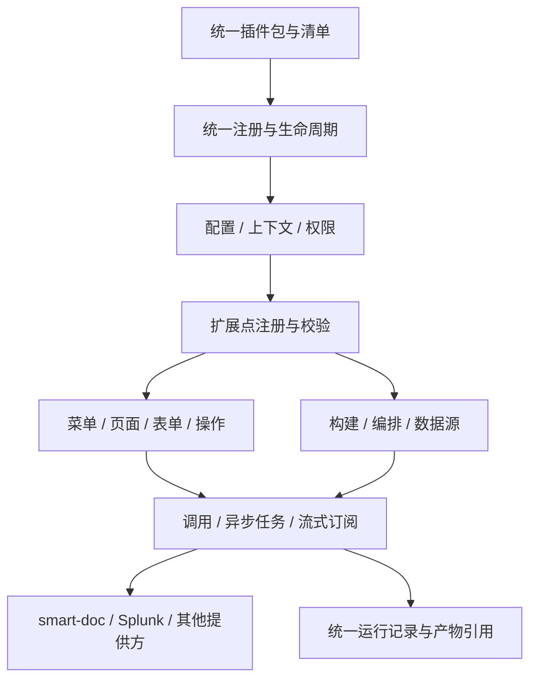

# Future：全局插件协议与渐进演进

状态：设计草案，尚未实现；用于后续分阶段迭代，不作为当前安装包格式或接口说明。

更新日期：2026-10-22。

当前可用协议、安装方式和限制以 [PLUGIN-PROTOCOL.md](PLUGIN-PROTOCOL.md) 为准。本文依据现有代码整理差距、目标和迁移顺序；下文的结构、扩展点名称与版本均为提案，不能直接用于现有安装器。

## 1. 要解决的问题

平台需要一套全局插件协议。日志、接口文档、来源平台、规则、构建、部署编排等功能使用相同的注册、配置、权限、执行和页面扩展机制，避免每增加一个功能就建立另一套插件机制。

用户已确认的方向：

- 功能继续保持独立入口，应用、环境、资源、凭据等关联数据共用，不把所有功能嵌入应用与构建。
- 配置一次，在获得授权的其他功能中引用；页面切换不要求重新配置同一条连接或机器。
- 插件可安装、启停和卸载；平台不依赖 Splunk、smart-doc、禅道等具体厂商实现。
- 低频插件优先按需启动，空闲后退出；不能把“插件已启用”统一实现成常驻进程。确需持续连接或订阅的插件才选择常驻，平台统一控制资源预算。
- 安装并启用插件后，才提供其新增入口或节点；历史配置和执行记录不能随插件消失。
- 实时日志必须保留。已有采集、WAL、日志存储和保留策略不因协议改造而被替换或清空。
- 前端优先使用官方 Arco Design Vue 组件，复用平台布局、主题、工作区和权限体系。

交付目标不是让所有业务使用同一种数据结构，而是让它们通过同一套插件基础设施声明、调用和扩展。业务模型属于能力契约，不另建插件框架。

## 2. 现有实现与实际差距

以下为本次代码核对结果，不代表已经完成目标架构。

| 范围 | 当前实现与代码位置 | 差距 / 后续处理 |
|---|---|---|
| 页面 / 工作区插件 | `internal/platform/manifest.go` 读取 `plugins/*/manifest.yaml`，支持进程和共享内置后端；网关提供 UI 路由 | 与可安装能力插件分别注册；共享后端 UI 路径仍有白名单。先适配到同一注册视图，不强行将内置服务改成独立进程 |
| 能力插件运行时 | `pkg/extensionprotocol/protocol.go`、`internal/extensions/manager.go`：ZIP、JSON 清单、独立回环 HTTP 进程、握手、鉴权、启停、并发限制；当前启用后进程保持运行 | 可复用底座，但当前单包单实例；尚无按需启动、空闲回收和完整资源配额，也没有统一页面贡献、依赖解析和升级迁移机制 |
| 调用与可信身份 | 统一 `Request/Response/Error`；平台覆盖 actor；Manager 检查能力、角色和固定版本 / 摘要；Broker 向受信后端开放受限能力 | 上下文和资源授权仍由各消费方处理；不能把 Broker 的管理员执行身份当作跨业务授权 |
| 配置表单 | 安装清单字段支持 `string/secret/json`；`ExtensionManager.vue` 渲染；文档来源又通过插件 `schema` 返回字段 | 有两处配置描述，能力表单主要文本输入；缺少统一作用域、结构校验和资源选择器 |
| 菜单与页面 | `web/src/shell/navigation.js` 静态业务菜单；另有扩展工具入口；Shell 与共享代码维护 iframe、工作区、主题和导航消息 | 可复用交互，但并非统一声明式页面协议；需避免同一插件在业务菜单和扩展工具中重复出现 |
| 日志 | Splunk 实现 `logs.search.v1`；`web/src/logs/externalSource.js` 调用能力插件；本地实时日志由 `LiveView.vue` 连接 WebSocket tail | 当前插件通道是有界普通 JSON 请求，没有通用流式订阅；Splunk 插件当前只实现历史查询，不能声称已支持实时订阅 |
| 规则 | `internal/platform/policy_extensions.go` 通过插件能力编译声明式规则，再交给平台处理 | 规则是能力的一种；继续保留领域校验，不再增加独立管理和调用体系 |
| 文档生成 | `pkg/apidoc`、`internal/smartdocplugin`：插件返回受约束生成计划，平台 Runner 执行；按应用 / 环境保存来源、文档快照和同环境对比 | 通用配置与输出消费可保留；前端高级构建页的文档卡片仍固定存在，尚未由安装状态统一控制 |
| 编排节点 | `pkg/workflownode`、`internal/deploy/workflow_extensions.go`、`/api/workflow-node-providers` 动态发现节点；支持文档和受限远程任务 | Binding 中存在 `Documents/DocumentTask` 专属结构；校验器按文档执行器 / 远程执行器分支，尚未形成通用节点绑定 |
| 异步与流 | 编排有 `job.status` 等局部任务处理；Manager 普通调用约 25 秒超时、2 MiB 响应上限 | 不能将长任务或实时流直接塞进普通请求；需统一任务状态、取消、恢复和流控制 |
| 生命周期与数据 | 可安装、配置、启停、重启恢复；卸载需先停用，当前删除包及插件私有配置 | 当前不支持无缝升级 / 多版本共存；未来需区分安装文件、绑定配置、历史记录和运行任务，显式处理引用关系 |

现有独立进程与平台使用同一操作系统用户，属于管理员信任的本机代码，不是安全沙箱。新协议不能仅凭权限字段就声称已隔离插件的系统访问。

## 3. 一个协议，多个扩展点

统一协议分为三层，统一维护，不形成三套插件体系：

1. **基础协议**：包、身份、生命周期、配置、权限、上下文、调用、任务、流、事件、数据归属、错误与兼容规则。
2. **扩展点目录**：平台能承接的位置，例如菜单 / 页面、页面操作、数据源、构建节点、编排节点、产物消费。由平台注册扩展点的输入、输出和限制。
3. **能力 Schema**：某项操作的输入、输出及结果语义。例如日志查询返回日志，文档生成返回文档产物。多个厂商实现同一个能力时，复用同一个契约。

业务契约可以不同，安装、鉴权、配置、调用、任务和前端桥接不能各做一套。声明未知能力只获得可发现的描述，不会自动产生领域页面、审批或执行权限。



### 3.1 关键对象

| 对象 | 用途 |
|---|---|
| Package | 已校验的插件包、版本、完整性摘要、运行平台与兼容声明 |
| Instance | 某个包的运行实例与连接配置；目标允许同一包连接多个外部系统，迁移时先保持旧实例标识稳定 |
| Capability / Operation | 可调用的能力和操作，声明输入输出 Schema、同步 / 任务 / 流模式及副作用类别 |
| Contribution | 将一个能力或页面挂到已有扩展点；包含稳定 ID、位置、权限要求和可用条件 |
| Binding | 应用、环境等业务范围对实例和配置的引用；有修订号，不复制另一份连接或密码 |
| Execution | 某次获授权执行的冻结上下文、包版本 / 摘要、配置修订、输入、状态与产物引用 |
| Artifact | 平台可保存或引用的输出，如 OpenAPI、测试报告、文件和差异结果；有类型、摘要和归属 |

包 ID、实例 ID、应用 ID、环境 ID、贡献 ID 均使用稳定标识；名称只作展示，不能用于身份关联或权限判断。旧环境使用名称等标识时先建立映射，不能直接猜测迁移。

## 4. 清单与统一配置

### 4.1 清单应声明什么

- 插件身份、包版本、基础协议兼容范围、宿主版本要求、依赖。
- 运行方式：按需独立进程、常驻独立进程、内置共享后端；声明启动 / 空闲回收策略与资源需求，由平台策略批准并限制，详见第 8 节。静态 UI 资源不要求后台进程常驻，外部远程服务暂不作为第一阶段必需项。
- 能力及操作：输入 / 输出 Schema、执行模式、副作用、限制与取消支持情况。
- 扩展贡献：挂载位置、引用的操作、可见性与使用权限、配置引用方式。
- 配置 Schema、作用域、迁移版本，以及允许引用的资源类型。
- UI 资源与文件完整性信息；现有 entrypoint SHA-256 不是整个安装包的签名，未来不能混为一谈。

下例只说明关系，省略包文件、Schema 定义和兼容细节，不是可安装清单。操作、扩展点和字段名称在协议冻结时统一确认。

```json
{
  "id": "smart-doc",
  "capabilities": [{
    "id": "api.document.generate.v1",
    "operations": [{
      "id": "generate",
      "mode": "task",
      "execution": "host-runner",
      "input_schema": "schemas/generate-input.json",
      "output_schema": "schemas/generate-output.json"
    }]
  }],
  "configuration": {
    "schema": "schemas/configuration.json",
    "scopes": ["application", "application-environment"]
  },
  "contributions": [
    {"id": "generate-on-build", "point": "build.node", "operation": "api.document.generate.v1/generate"},
    {"id": "generate-in-workflow", "point": "workflow.node", "operation": "api.document.generate.v1/generate"}
  ]
}
```

### 4.2 统一 Schema 与表单

采用 JSON Schema 的明确、版本化子集表达数据结构，展示提示单独描述。首先固定支持范围，再逐步扩展；未支持的必需关键字在安装 / 注册时拒绝，不能静默忽略约束。

- 支持文本、数字、布尔、枚举、数组、对象；支持必填、范围和条件校验。
- 应用、环境、资源、凭据使用平台提供的受控选择器，保存稳定引用；不是插件自造查询接口或直接保存密码。
- 前端使用 Arco 组件统一渲染；服务端根据同一 Schema 再校验，浏览器校验不能作为授权依据。
- 凭据保留 / 替换 / 清除使用明确操作，不把空白误当作删除；秘密不回传前端，不进入日志和普通历史。
- 错误携带字段路径，前端定位并聚焦；Schema 有大小、深度和选项数量上限，不执行插件提供的 JavaScript 校验器。

### 4.3 配置作用域与引用

区分实例连接配置、应用配置、应用＋环境配置。环境默认值只对声明可继承的字段生效；业务绑定不能在不同应用、用户间隐式共享。具体合并规则随 Schema 版本确定并返回“有效配置及来源”，避免只有代码知道覆盖关系。

同一份 Binding 由构建、编排和独立页面引用。修改采用修订号并发校验；执行时冻结有效配置，审批后的修改只影响下一次执行。凭据通过受控引用及可审计修订解析，秘密快照如确有必要需单独加密和保留策略。

工作区可记住展示筛选，不能把选中的执行目标、凭据和批准信息作为通用偏好自动复用。

## 5. 统一调用、任务、流和事件

### 5.1 通用调用信封

在现有 Request / Response 基础上演进，统一表达请求关联 ID、实例、能力 / 操作、可信身份、范围上下文、输入与 Schema 版本、包和配置版本约束、期限 / 取消、结果、错误和产物引用。

actor、范围权限、批准凭据和执行身份均由宿主校验和注入。插件不能通过 input 或网页消息声明自己是管理员；上下文包含应用 ID 也不代表已经获得该应用访问权。

普通请求保留有界响应；分页游标绑定实例、配置修订、启动代次和查询范围。大文件使用有权限与大小限制的产物通道，不绕过当前 JSON 上限。

### 5.2 三种执行模式

| 模式 | 适用场景 | 统一语义 |
|---|---|---|
| Request | 查询、连接测试、规则编译、短时间计划生成 | 有界输入输出、超时、取消、错误、分页 |
| Task | 文档生成、接口用例执行、其他长任务 | 创建后返回 execution ID；状态、进度、日志、结果、取消、重启核对 |
| Stream | 实时日志、持续进度等 | 订阅 ID、事件序号、心跳、背压、断开 / 结束原因、续传能力声明 |

异步任务统一状态至少包括 queued / running / cancel-requested / succeeded / failed / canceled / unknown。取消请求不等于外部副作用已停止；超时或断线后结果不明确时进入 unknown，通过查询核对，不自动重新执行。

幂等键与冻结输入、目标、版本绑定，由宿主记录；当前 `request_id` 主要用于关联且会由 Manager 生成，不能直接宣称已有幂等保证。只对明确支持的操作承诺幂等，不承诺跨数据库、主机和外部服务的事务回滚。

### 5.3 流与实时日志

流式订阅是统一协议的一等能力，不用普通 `/invoke` 长轮询冒充实时流。插件 / 宿主间与浏览器边界的传输方式在这一阶段确定，可采用 SSE / WebSocket，但消息语义、权限与取消规则统一。

- 订阅开始固定应用、环境、数据源和过滤条件；换工作区或范围创建新订阅，旧流不能覆盖新流。
- 明确队列上限、背压和丢弃策略；发现缺口返回 gap 及可补查范围，不能静默丢失后显示正常。
- 声明是否支持重放与游标续传；只有提供方确实支持时才能显示“已恢复”，不承诺 exactly-once 或绝对不丢。
- 停用插件要关闭订阅并说明原因；权限变化和会话过期停止推送。
- Splunk 实时能力需现场版本、权限和接口验证；只实现历史查询时，前端明确标示“不支持实时”。

迁移期间本地 `/api/tail` WebSocket 保持原链路可用，之后通过内置提供方适配统一 Stream。采集 Agent、WAL 重放和日志存储的数据面不能被控制台插件管理替换；UI 显示缓冲上限也不等于底层存储丢失。

### 5.4 平台事件

事件用于配置变更、插件状态、构建完成和产物产生等通知，不承载执行授权。声明事件类型 / Schema、事件 ID、来源、范围、发生时间与因果关联；明确重复、乱序和补发语义。

事件订阅先限定为已注册、经过授权的消费者。外部副作用必须经过执行器和既有审批；不能收到一次 `build.completed` 就绕过构建环境解析、范围冻结或审核自动发布。

## 6. 执行权、资源与产物

### 6.1 宿主执行与提供方执行

统一任务协议允许不同执行位置，但不改变资源控制边界：

- **host-runner**：插件返回经校验的声明式计划，由宿主使用已授权 Runner、源码 / Commit、工具链和制品执行。smart-doc 先保留这种方式，不把仓库路径和全套凭据交给插件进程。
- **provider**：外部服务或插件自身承担操作，通过统一任务适配器报告状态和结果；平台核对目标和授权。现有只读远程节点先保持只读限制。

具体执行器通过受控注册表接入，按类型验证计划；扩展点声明不等于任意 shell 执行权限。不能为了删除 smart-doc 分支，就改成无校验的脚本执行器。

构建节点、编排节点、手动执行均引用同一 Operation 与 Binding；它们只负责触发时机和业务上下文，不再定义另一套任务协议。

### 6.2 权限与平台服务

保留管理员 / 成员角色，审核人仍来自现有审批节点。清单声明的是所需权限，授予由宿主完成；还需校验应用、环境、资源范围以及操作副作用。

提供平台服务的版本化受控调用：查找应用 / 环境、解析已绑定资源、读取允许的产物、提交结果。使用短期且限定范围的执行凭据；插件不能直接访问数据库或通过未受限通用代理取得全部平台连接。

身份认证失败、外部系统认证失败、资源无权访问分别表达。不能把 Splunk / 禅道的 401 当作平台会话失效并把用户踢回登录页。

### 6.3 输出与历史

通用 Artifact 记录类型、摘要、存储引用、提供方、执行、应用 / 环境、源 Commit 与制品关联等来源信息。元数据与秘密分开，下载和查看时再次鉴权。

领域模块根据受支持的产物类型消费结果：接口中心识别 OpenAPI，保存文档快照并做同环境对比；通用运行中心只展示状态和引用，不自行解释接口兼容性。

卸载插件不能删除构建记录、文档快照、对比基线或测试报告。历史详情不依赖旧插件在线；原插件已不可用时不能伪装为可重新执行。

## 7. 前端扩展与工作区

### 7.1 常规交互由宿主渲染

菜单、页面入口、动作、选择器和节点编辑器由 Contribution 绑定已有扩展点。名称、图标、顺序、业务分组和访问要求通过统一描述校验，避免一个插件被重复放到接口中心和扩展工具。

菜单可见性不等于 API 授权。启用且兼容 / 描述校验通过后开放新增入口；按需进程休眠时入口仍可见，真正调用前再启动并握手。已停用但仍被业务配置引用时显示“不可用 / 修复配置”，不是静默移除用户配置。历史页面继续使用原快照展示。

不要求所有功能通过自定义 JSON 页面重建。优先复用平台已有业务页面和 Schema 表单，统一 Arco 主题、字体 / 图标尺寸、空状态、错误和加载行为。

### 7.2 特殊页面使用统一 UI Bridge

确有复杂交互时，插件可以声明独立静态页面，通过版本化 UI Bridge 与宿主通信。先适配当前 iframe 机制，再明确资源完整性、允许来源、CSP 和隔离范围；不动态执行插件返回的 Vue 片段、HTML 脚本或任意 npm 模块。

Bridge 至少包含握手、请求 / 响应关联、能力协商、受控 API 调用、工作区导航、dirty / busy、可见性、主题与上下文。校验 origin、来源窗口、工作区与消息 Schema；不会直接暴露进程 Token 或凭据。

跨功能导航打开目标工作区或明确的就地弹窗，返回后保留原页筛选、分页、草稿和详情。上下文更新不隐式导航，不将其他页内容渲染进原标签。迁移时继续使用现有导航回归链路验证。

## 8. 生命周期、兼容与热插拔

热插拔表示可在不重启整个平台的前提下管理插件，不表示运行中的任意任务都能无缝切换版本。

### 8.1 三种运行方式与默认选择

运行方式描述提供方如何承载，不等于第 5.2 节的 Request / Task / Stream 调用模式，也不等于 host-runner / provider 的执行位置。它们共享同一协议，不另建三套安装器或调用接口。

| 运行方式 | 启动与退出 | 适用场景 | 资源与边界 |
|---|---|---|---|
| `on-demand`：按需独立进程 | 首次实际调用前启动，握手后执行；最后一个有效请求 / 任务租约 / 订阅释放后，按有界空闲时间回收 | 文档计划、规则编译、扫描、低频查询及短期适配任务；新外部插件的默认选择 | 有冷启动成本；可短时复用，不能为了健康轮询反复唤醒或维持常驻 |
| `persistent`：常驻独立进程 | 启用后启动并受守护；停用、升级或故障时退出 | 确需持续连接、主动接收事件或存在持续订阅，且短时启动无法满足的场景 | 常驻会占基础内存和连接，必须声明理由并经平台策略允许；不能因插件叫 Splunk 就默认常驻 |
| `builtin-shared`：内置共享后端 | 跟随已有平台 / 内置服务的生命周期；功能启停控制入口和调用 | 平台自身页面、已有受信业务模块和本地数据源适配器 | 不增加独立插件进程，但资源仍记入共享服务预算；不能停止共享后端来停用其中一个功能 |

默认原则：低频或无持续订阅的外部能力优先 `on-demand`；不创建最低常驻进程池，不按应用、环境、菜单或节点各启动一份相同适配器。实例、版本、配置隔离确定复用边界，运行规模由平台策略控制。频率高不自动转为常驻，先用指标判断冷启动成本，再由管理员明确调整。

`builtin-shared` 只允许宿主已有的内置适配器，不支持通过第三方安装包把任意动态库 / 源码加载到平台主进程；它不能承诺与独立进程相同的故障隔离和独立热升级。

smart-doc 默认按需：插件完成配置校验 / 计划生成且没有其他调用后可回收；真正的 Maven / Java 任务仍由 Runner 按执行租约管理，不能因适配器空闲回收而终止它，也不能把 JVM 开销漏算。仅有历史查询的 Splunk 同样可按需；实时订阅存在时才持有运行租约，最后一个订阅结束后允许回收。静态页面、配置表单和历史详情读取不唤醒插件进程。

### 8.2 按需生命周期与并发

管理状态与进程状态分开：`enabled + dormant` 表示可调用但尚无进程，不显示“离线 / 故障”。安装只保存并验证包；启用登记贡献与有效配置，不要求长期驻留。动态描述可在一次有界探测中获得，缓存与包摘要 / 配置修订绑定，探测完成后退出；不能为刷新菜单启动进程。已有 v1 提供方先保留原行为并标明兼容模式，未经适配不得直接宣称支持休眠。

- 唤醒前先鉴权、校验范围并取得平台启动 / 并发预算；相同实例、版本与配置的并发首次调用合并为一次启动，禁止启动风暴。
- 调用计入冷启动等待，分别限制排队、启动握手、单次调用和任务总时长。启动失败释放配额并返回可恢复错误；用户取消等待不自动取消其他调用共享的启动过程。
- 运行期间维护请求、任务和流的租约；空闲回收与新调用原子协调。不能只按“最近 HTTP 请求时间”结束仍在执行的异步任务或订阅。
- 只有已明确脱离插件进程、状态持久化且可核对的外部任务，才允许释放该进程的任务租约；否则等任务终态或明确取消。不能回收后重新发送一次任务创建请求。
- 空闲时间到达后先停止接收新请求，再关闭连接、终止受管进程树并回收临时资源；新调用等待正常结束后按当前版本启动，不能路由到退出中的实例。
- 重启、崩溃或配置 / 版本变化后更新启动代次；原游标、订阅和令牌按协议失效 / 核对，只有明确支持续传的只读流可恢复。进程可重启不代表业务写入可重放。
- 故障重启有退避、次数上限和熔断；按需插件没有请求时不主动重启，常驻插件也不得无限快速拉起。

### 8.3 统一资源声明与平台强制策略

清单只声明需求与支持能力，不能自行授予资源。平台生成“申请值 / 平台上限 / 最终生效值 / 实际保障方式”，管理员可在平台边界内调整；值的单位、上下界和缺省规则在 P0 固定。以下字段名称为提案，不是当前清单支持字段，不先填未经测量的通用内存或 CPU 数字。

| 控制范围 | 需要统一表达的内容 |
|---|---|
| 运行与启动 | 运行方式、冷启动超时、空闲回收时间、优雅退出时限、重启退避与上限 |
| 平台总预算 | 最大活跃进程、同时冷启动数、CPU / 内存可分配预算、任务与流配额；为核心服务保留余量 |
| 实例预算 | CPU、内存、进程 / 子进程数、打开文件数、连接数、请求速率；不同实例不能相互拖垮 |
| 并发与排队 | 最大并发请求 / 任务 / 订阅、有界队列、排队期限；超额排队或拒绝并明确原因，不能无限累积 |
| 数据与磁盘 | 输入输出大小、产物与临时目录额度、运行日志大小 / 保留、流缓冲与背压；自动清理仅限明确归属的临时数据 |
| 外部与 Runner 工作负载 | 子进程树、Maven / JVM / 容器、远程任务的归属与限额；复用已有 Runner 资源调度，不另建无界执行池 |

独立进程的限制覆盖受管子进程 / 容器，不能只统计 Go 适配器。取消 / 超限后的清理要限定到本次 execution 和进程归属，不能误杀共享 Runner 或其他实例；不明确的外部副作用保留 unknown 并核对。包占用、常驻基线、运行峰值、共享后端和 Runner 用量分别展示，避免重复记账或漏算。

Linux 可通过 cgroup / 容器等实施硬限制；macOS 本地开发、远程 Runner 和共享内置服务能提供的限制不同。运行时须报告每项约束是硬限制、监测告警还是不支持，不以清单数值冒充隔离。声明必需硬限制而目标运行时不支持时，拒绝调度并说明；内置共享后端不能承诺独立功能级的硬内存隔离。

内存超限 / OOM、CPU 限流、排队过期、冷启动失败和普通业务失败分别记录。资源不足不默认为自动扩容或重试写任务，也不能为腾出资源终止核心日志采集、WAL 或未核对的执行。

### 8.4 可观察性与资源验收

插件管理按实例展示声明方式与生效方式、启用 / 休眠 / 启动 / 运行 / 回收 / 故障状态、活跃租约、队列和最近回收原因；资源视图展示基础内存、峰值内存、CPU 时间、启动耗时、冷 / 热调用延迟、子任务用量和超限次数。采样无数据时显示未知，不填 0 伪装为无开销。

以合成负载分别测量“未安装 / 已安装未启用 / 启用但空闲 / 首次调用 / 热调用 / 并发任务 / 订阅结束后”的状态，在同一运行环境比较并记录条件：

- 多个低频插件启用但空闲时，不长期保留独立进程；菜单和历史详情可用且不触发唤醒。
- 并发首次调用只启动一份允许复用的实例；达到总预算时有界等待 / 拒绝，不挤占核心服务。
- 最后一个租约结束后在配置空闲期内回收；仍有任务 / 实时订阅时不误杀，取消和停用有明确结果。
- 验证进程 / JVM 峰值、限额生效、退出后子进程和临时文件回收、OOM / 启动失败后的资源释放与退避。
- 休眠 / 再唤醒不丢配置、不串用户 / 应用范围、不自动重放任务；本地实时日志链路继续可用。

具体默认预算、空闲时间和常驻批准条件由这些测量确定。当前尚无本轮插件资源实测，本文不承诺固定内存开销或现有运行时已支持上述限制。

### 8.5 安装、升级与兼容行为

- 安装：先验证包、资源路径、摘要、兼容范围、依赖、Schema 和贡献位置。未知必需扩展点拒绝启用；可选扩展显式报告未激活。
- 启用：按运行方式校验 / 探测并发布注册视图；按需实例默认休眠，实际调用时启动、握手和协商，常驻实例启动就绪后开放调用。前端按注册修订刷新，旧响应不覆盖新状态。
- 停用：先停止接收新任务 / 订阅，列出在途任务和引用；按操作能力等待、取消或核对，不能直接把任务标成功。历史可读。
- 升级：先预检新包与配置迁移，再在可恢复的边界切换。既有任务固定旧版本和摘要；尚无多版本运行支持时，阻止切换或要求先完成在途任务。
- 卸载：展示依赖和 Binding 影响，区分删除安装文件、保留配置、解除引用与清理秘密。历史不删，外部系统不删；不能沿用当前卸载就全部删除配置的语义而不作迁移提示。
- 回退：保留可回退包与配置备份，执行记录不覆盖。不可逆的数据迁移需明确边界，不宣称升级失败可以自动回滚所有业务状态。

基础协议、能力 Schema、配置 Schema 和 UI Bridge 独立版本化。旧 v1 先由适配器进入统一注册表；破坏性格式变化通过新 major 协商，不能直接改变 `protocol: 1` 的含义。

内置 / 第三方共享注册和消费路径，但内置关键服务可声明为不可卸载；“统一管理”不要求将 delivery-core、日志存储等全部拆成外部包。

## 9. 现有插件的迁移映射

| 当前实现 | 演进方式 | 必须保留 |
|---|---|---|
| `manifest.yaml` 页面插件 | 内置适配器生成统一描述和页面贡献；逐步替换静态菜单来源 | 原 URL、工作区标识、已有业务路由、共享后端运行方式 |
| `manifest.json` 能力插件 v1 | v1 适配器保留握手、调用、配置和包校验；新协议逐步接管注册和消费 | 旧 ZIP 可安装 / 启用、旧实例与授权规则，不声称已自动升级 |
| Splunk `logs.search.v1` | 接入统一数据源扩展点，输入输出继续使用日志 Schema；Stream 另行声明 | 原查询范围、字段映射、游标失效语义、连接凭据；真实联调限制 |
| 本地日志与实时 tail | 先作为内置数据源描述，后续适配统一 Request / Stream | 实时入口、重连 / 重放行为、原采集和 WAL 数据链路 |
| smart-doc `schema/plan` | 统一 Schema 取代专属配置获取；host-runner 适配器复用现有计划校验与执行 | 应用 / 环境配置、工具链隔离、源码 / 制品来源、快照 ID 和同环境基线 |
| `workflow.node.v1` | Descriptor 转为 Contribution；Binding 转为 Operation + 配置引用 + 冻结输入 / 产物引用 | 原批准与执行边界、旧记录读兼容；不引入已明确移除的旧独立准备流程兼容 |
| `DocumentTask/Documents` | 新任务不再以文档专属字段写入通用编排绑定；旧快照使用只读适配器解析 | 不重写已审核或已完成快照；不靠当前应用配置还原旧输入 |
| 远程只读任务 | 适配现有 `job.status` 等处理到通用任务服务 | 首版只读限制、原 execution ID、重启后核对，不重复触发 |
| 规则编译 | 按能力 Schema 注册并接入现有规则消费方 | 来源字段原始编码、缺字段时的待确认语义、人工调整优先级 |
| 禅道等来源适配 | 后续作为来源连接与同步能力接入，同步与写回分别授权 | 现场字典、来源连接身份和原始编码；未实现的同步 / 写回不标为可用 |

迁移脚本必须可预览、校验数量 / 引用、重复运行不重复创建。先建立旧新 ID 映射，再切换读取；分阶段停止旧写入口，避免永久双写。不得因统一协议删除用户数据或重置日志保留设置。

## 10. 分阶段落地与验收

截至本文编写，下列阶段均为待实施；现有相关局部实现不等同于阶段完成。以验收条件决定进入下一阶段，不在此承诺日期。

### P0：冻结契约和兼容基线

交付：基础协议 / 扩展点 / Schema 的职责划分，版本与权限规则，v1 映射，统一类型草案，最小兼容样例；确定三种运行方式、低频按需默认、资源字段 / 单位与保障能力声明，对现有 UI 和运行时回归建立基线。

验收：smart-doc、Splunk、内置页面和只读任务都能用同一模型表达；没有文档专属字段进入通用 Binding；协议草案与当前使用说明清晰分开。

### P1：统一注册表与生命周期视图

交付：页面插件与能力插件适配器、稳定 ID、描述查询、注册修订、统一插件管理视图；保留原运行时。

验收：两类插件在同一管理入口可查看且无重复菜单；启停只影响所属入口 / 新调用；旧 ZIP、原 UI URL 和独立工作区可用；不重启关键内置服务。注册视图区分“启用”与“进程运行”，现有常驻 v1 实例标为兼容行为，不误标已支持按需回收。

### P2：统一配置、上下文与前端贡献

交付：共享 Schema 验证 / 表单渲染、配置作用域与修订、受控资源引用、菜单 / 动作 / 节点贡献，以及 UI Bridge 旧消息适配。

验收：新建同类插件不改平台前端即可出现入口、配置和节点；字段错误可定位；同一应用 / 环境 Binding 在构建和编排复用；返回页、主题、dirty / busy 和成员权限回归通过。

### P3：统一执行与产物，迁移 smart-doc

交付：Task 服务及恢复 / 取消语义、host-runner 适配器、不可变执行快照与产物引用；按需启动 / 合并唤醒 / 租约回收、平台与实例资源预算及运行时保障报告；替换构建页固定文档卡片和新编排绑定中的专属字段。

验收：第二个符合文档生成契约的提供方仅安装包即可接入节点和文档历史；开发 / 测试环境按现有规则自动生成，生产默认不开启；同环境对比、必需 / 可选失败策略及旧快照可读；无额外构建 / 发布副作用。多个低频插件启用后空闲不常驻；冷启动、并发首次调用、超限、任务租约、子进程清理和退出后的资源基线有实测证据。

### P4：统一数据源与 Stream，迁移日志

交付：数据源扩展点、Stream 生命周期 / 背压 / 缺口语义、本地提供方适配、Splunk 查询迁移；外部实时能力按验证结果启用。

验收：本地实时日志在迁移前后都可用；筛选与工作区隔离正确；断开、取消、重连、gap 与插件停用可观察；查询失败不静默切换数据源；Agent / WAL 与保留策略无回归。活跃订阅不被空闲回收；最后一个订阅释放后按需实例可退出，流配额与背压不挤占核心采集预算。无真实 Splunk 环境时，只能标记模拟验证完成。

### P5：升级迁移、开发者工具与后续能力

交付：依赖预检、包 / 配置升级及回退流程、开发 SDK / 示例 / 校验 CLI、契约兼容测试；再逐步迁移规则、来源平台与其他功能。

验收：老版本兼容规则可自动检查；升级失败有可验证恢复路径；在途任务固定版本，未知结果不重放；插件作者按统一文档完成安装、页面、节点、查询和任务示例，不复制宿主业务分支。

## 11. 测试和证据要求

- 契约测试：包 / 路径 / 摘要、Schema、版本协商、错误码、上限、字段类型、必需扩展点与依赖。
- 安全边界：伪造身份 / 范围 / Bridge 消息被拒绝，跨应用 / 环境 / 实例不可读取；秘密与运行 Token 不进入页面、日志或普通快照。
- 生命周期：启用失败、停止中调用、进程退出、重启恢复、实例隔离、升级 / 回退、卸载后的历史与失效引用。
- 资源与按需运行：启用休眠不误报离线、静态页面不唤醒、并发唤醒合并、请求 / 任务 / 流租约、空闲回收竞争、平台总预算和实例限额、进程树 / Runner 用量、超限清理与退避；硬限制不支持时正确拒绝。冷 / 热启动与内存 / CPU 对比记录测量条件。
- 任务：重复提交、并发、取消未确认、超时 unknown、进程崩溃和版本变化；对有副作用操作不以自动重试作为恢复。
- 流：有界缓冲、背压、游标过期、gap、重连、会话失效、切换范围和旧事件污染；不能只验证能收到一条日志。
- UI：官方组件、主题 / 尺寸、独立工作区、导航返回、配置一次多处引用，以及管理员 / 成员入口差异。
- 数据迁移：临时 SQLite 与受控 MySQL 环境核对 ID、数量、引用、修订与不可变历史；未执行的数据库验证需明确记录。
- 验证优先使用临时数据、模拟插件、假 Runner 和合成日志；不为测试界面执行真实远程构建、发布、SQL、Redis、配置发布或来源 Bug 写回。

每阶段在 [UI-INTERACTION-ACCEPTANCE.md](UI-INTERACTION-ACCEPTANCE.md) 记录实际测试、截图 / 日志证据、未验证范围和部署状态；不能用“协议设计完成”替代“运行能力已上线”。

## 12. 后续迭代的约束与待决项

新增功能先检查可复用的 Operation、扩展点、资源引用和 Schema；只有确实缺少业务语义时才新增能力契约。不得再新增功能专属安装器、插件注册表、身份信封、配置渲染器、任务管理和页面桥接。

P0 必须确定：

1. 新清单 major / 协商方式与旧 YAML、JSON 的适配边界。
2. JSON Schema 版本及支持子集、UI 提示格式、资源选择器注册规则。
3. 扩展点目录、稳定 ID 命名与必需 / 可选贡献的兼容规则。
4. 配置继承与 Binding 修订规则，以及任务 / 秘密快照的保存边界。
5. 三种运行方式与低频按需默认、管理 / 进程状态分离、租约和回收边界；统一资源字段的单位 / 上下界、平台策略覆盖规则与运行时保障能力。

进入对应阶段前确定：

- Stream 传输、续传和持久化边界；外部提供方无法补查时的 UI 行为。
- 自定义 UI 的来源隔离与 CSP；受信本机代码到更强隔离模型的实际实施范围。
- 包完整性覆盖范围与后续签名信任链；不能将哈希校验称为发布者可信认证。
- 多实例、多版本共存与依赖升级策略；没有运行时支持前不承诺无缝热升级。
- P3 的实测资源预算、空闲回收时间、常驻批准条件及各目标系统的限额实施方式；不能因为已有 v1 启用即常驻，就把常驻延续为新协议默认行为。
- Artifact / Execution 数据模型、保留期限与领域历史如何引用，不复制成第二套业务事实。

这些决策应回填本文及对应实现协议，再开发落地；后续完成一个阶段就更新该阶段状态，不能把整个 Future 文档一次性标为已完成。

### 2026-10-22 交付回归落地补充

接口测试节点沿用 `workflow.node.v1` 的 Descriptor / Binding，新增宿主批准的 `api.test.execute.v1` 执行器，声明 `effect=http-request`，不能冒充只读。API-center 复用交付后端，作为受信任共享提供者登记；安装工作区后参与节点发现，无独立描述器进程。Descriptor 的可选 binding_path / binding_label 为宿主布局提供配置入口，节点表单不按 smart-doc 名称硬编码。

应用环境只维护一次团队测试集与目标绑定；预览冻结定义、环境、制品、配置及变量摘要，任务使用现有接口测试引擎/台账。报告、取消和幂等不另起功能专属服务，未确定结果不补发。该落地是现有版本化节点协议的一种共享执行方式，不表示此 Future 的完整通用贡献、运行时资源隔离、任务迁移与热安装规范都已实现。当前共享工作区的安装/启用仍以启动时 manifest 发现为准。
